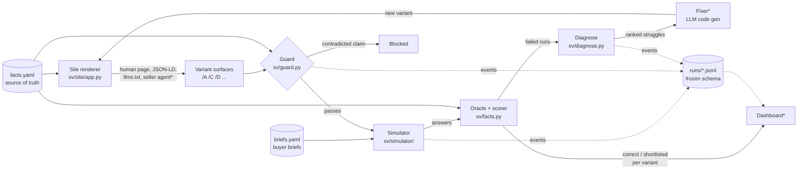

# Architecture

Second Visitor is a loop: **simulate → diagnose → fix → guard → ship**. One source-of-truth
file feeds every surface the site shows, a population of buyer agents tests those surfaces,
and a guard blocks any variant that tells agents something the source of truth doesn't support.

`*` = not built yet (see Roadmap).

## Components

| Component | File | What it does |
|---|---|---|
| Source of truth | `data/facts.yaml` | Plans, per-seat prices, features per plan, compliance status, regions. The only place facts live. |
| Buyer briefs | `data/briefs.yaml` | What a person's own agent carries: seats, billing, budget, requirements, permissions. |
| Site renderer | `sv/site/app.py` | FastAPI app serving every variant side by side under `/{variant}/`. All variants render from the facts; a variant may only change presentation, `extra_claims`, or (to simulate an unguarded optimizer) `fact_overrides`. |
| Buyer agent | `sv/simulator/agent.py` | Tool-calling loop (`open_url`, `submit_answer`). Fetch mode: reads pages the way agent fetch tools do, without JavaScript (`pagetext.py`), keeping links and JSON-LD. Runs in-process via `TestClient`, so no server is needed. |
| Oracle + scorer | `sv/facts.py` | Computes the correct decision for each brief from the true facts. Scoring is deterministic, so no LLM grades anything. Two metrics: **correct** (the agent's decision matches the facts) and **shortlisted** (the agent kept Pulse in play, which is what a naive optimizer would maximize). |
| Experiment runner | `sv/simulator/run.py` | variants × briefs × models × repeats, run in parallel. Prints per-variant rates with n and 95% Wilson intervals. |
| Diagnose | `sv/diagnose.py` | Tags each failed run with one named struggle (`price_hidden`, `gated_content`, `requirement_unstated`, `vague_wording`, `misread`). Failures roll up into a ranked list, Introspection-style. |
| Guard | `sv/guard.py` | Pulls every surface of a variant (each page plus llms.txt), extracts factual claims, and checks each against the true facts. **Contradicted → block. Unsupported → review** (usually a fact missing from facts.yaml, not a lie). |
| Event log | `sv/events.py` | Append-only JSONL with a frozen schema. The dashboard only reads events, so replaying a recorded run looks identical to a live one. |
| LLM client | `sv/llm.py` | One OpenAI-compatible client through the Respan gateway. Buyer population: Claude Haiku 4.5, GPT-5-mini, Gemini 2.5 Flash. Guard and diagnosis use Claude Sonnet 5.5. |

## Variants

| Variant | What it is |
|---|---|
| **A** (control) | A typical human-optimized SaaS site. Prices computed by JavaScript from a seat slider, SSO listed only as "Enterprise: contact sales", SOC 2 behind a Trust Center login, EU residency buried in the FAQ. No llms.txt. |
| **C** (fixed) | Same facts, readable by agents: static per-seat and team-size price tables, a feature matrix, a public compliance table, JSON-LD, llms.txt. All wording derived from the facts. |
| **D** (unguarded optimizer) | C rendered from *altered* facts: SAML SSO on every plan, SOC 2 Type II "certified". Consistent across every surface, which is what a metric-chasing optimizer would produce. |

## Results so far (offline, fetch-mode agents)

`ab-2`: 5 briefs × 3 models × 2 repeats = 30 runs per variant.

| Variant | Correct | Shortlisted | Guard |
|---|---|---|---|
| A | 40% [25–58] | 67% [49–81] | n/a (control) |
| C | **77% [59–88]** | 57% [39–73] | **PASS** |
| D | 67% [49–81] | **73% [56–86]** | **BLOCKED** (contradicted claims on every surface) |

- **The reward hack, measured:** D has the highest shortlist rate and lower correctness than
  C. On the SOC 2 Type II brief, C was correct 6/6 and shortlisted Pulse 0 times; D was correct
  2/6 and shortlisted Pulse 4 times. The lie worked on agents, and the guard blocks it before
  launch.
- **A's top struggles:** `price_hidden` (10), `gated_content` (6).
- **Caveats:** intervals overlap at n=30. Run `--n 4` or more before quoting numbers on stage.
  Fetch mode only; browser agents that execute JavaScript would do better on A.

## Design rules

1. **Same facts for every audience.** Variants may change presentation, never facts. Serving
   agents different facts is cloaking.
2. **No LLM grades pass/fail.** The oracle is deterministic; LLMs only diagnose and fact-check.
3. **Paired comparisons.** Every variant gets the same briefs, models and repeat count.
4. **Report n and intervals**, never single runs.
5. **Frozen event schema.** Add fields, never rename them.

## Roadmap

1. **Fixer**: an LLM reads the ranked struggles plus the current template and writes a new
   variant template (the code-gen theme). The guard and simulator then test it automatically.
2. **Seller agent (variant E, agent-to-agent)**: `POST /{variant}/agent` answers a buyer brief
   from the facts; the guard checks every answer before it is returned. Advertised in llms.txt
   and an agent card.
3. **Dashboard**: reads `runs/*.jsonl`, with a live correct-vs-shortlisted chart per variant, the
   struggle leaderboard and the guard's blocked-claims log.
4. **Browser mode**: Playwright-backed `open_url` for agents that execute JavaScript.
5. **Real-site read-only probe**: run briefs against a few real SaaS pricing pages for one
   "how many agents could verify SSO" slide.
