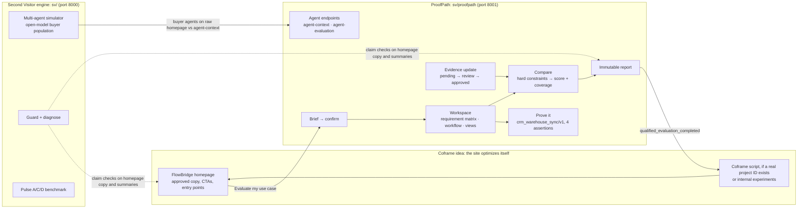

# ProofPath: integrated build plan (Living Internet Build Day, 2026-10-10)

**Source of truth: [proofpath/README.md](proofpath/README.md), section "Hackathon implementation
specification".** Where this file and the README disagree, the README wins. **The executable multi-agent
playbook (workstream briefs, integration, deployment, demo/video) is
[proofpath/plan/README.md](proofpath/plan/README.md).** This file adds what the README leaves open: how Second Visitor and the Coframe idea plug in, which models run where, and
the build order.

> *Enterprise software websites make buyers do the translation. ProofPath is a website that builds
> an evaluation around your problem, runs the proof, and revises the decision when the evidence
> changes, for humans and their agents alike.*

## 1. What we are building (from the README, unchanged)

- **FlowBridge**, a fictional integration vendor (CRM → warehouse sync), plus fictional alternatives
  **RelayWorks** and **PipeStack**. Labeled "Fictional products and evidence; live tests use local
  mock integrations."
- **Scope:** one workflow, three brief presets (EU technical, US operations, strict budget), two
  stakeholder views (technical, finance), four executable POC assertions, three products, one
  controlled evidence update, a structured agent endpoint, an immutable HTML report.
- **Three visible changes on stage:**
  1. the site adapts to a buyer brief
  2. a real bounded test produces evidence
  3. an approved source update changes the evaluation while the old report stays frozen
- **New package `sv/proofpath/`** with FastAPI + Jinja, Pydantic contracts, SQLite (standard
  library) and polling. Runs on port 8001. Pulse A/C/D and the simulator stay intact on port 8000.
- **Deterministic core:** fit decision rule, comparison scoring, POC assertions. Models parse,
  summarize and act as buyers, but never approve claims or change results.

## 2. How the three ideas fit

**The Coframe idea stays intact, and gets a better metric.** Coframe's loop experiments with
copy, CTAs and entry points. ProofPath gives it a conversion event worth optimizing:
`qualified_evaluation_completed` (confirmed requirements, no unresolved hard constraints, current
approved evidence), instead of clicks or form fills. Coframe may only experiment on
presentation; findings, test outcomes, citations and decisions are rendered by the application.
If no real Coframe project ID is available, the page shows "Coframe integration not configured"
(README rule).

**Second Visitor's role:**
1. **Agent and measurement workstream.** The simulator sends open-model buyer agents to the raw
   FlowBridge homepage and to `/agent-context`, and scores their decisions against the fixture
   expectations. This is the headline: "agents decide correctly N% from the homepage, M% from ProofPath."
2. **Guard** for the generated parts (summaries, homepage copy), with Jev for fast per-claim
   decisions. The README rule holds: the deterministic tests are the real verification, and the
   guard is never the only check.
3. **Pulse A/C/D** stays as the reward-hack benchmark slide (lies raise the shortlist rate and lower correctness).

## 3. Organizer themes → where they live

| Theme | Implementation |
|---|---|
| Multi-agent simulator on the web | Open-model buyer population, homepage vs agent-context |
| Personal agent protocol | The confirmed **BriefVersion**: a human edits and confirms it; an agent reads it via `agent-context` |
| Agent-to-agent | `POST /evaluations/{id}/agent-evaluation`: a buyer agent consumes the structured API and returns a cited decision |
| Living / generative UI | Homepage turns into a workspace built around the brief; the evidence update revises the decision live |
| Code gen | Stretch: generate homepage variants for Coframe-style experiments, guard-checked |

## 4. Models: cloud, open-weight first

All models are **cloud-hosted**. Nothing runs on the laptop (M2, 8 GB, too small). Open-weight
models go through OpenRouter on the existing Respan key. Tested today on our own tasks:

| Role (README boundary) | Primary (open-weight) | Fallback | Evidence from today |
|---|---|---|---|
| Parse buyer text → candidate requirements (validated against an allowlist; invalid → preset/form) | **Gemma 4 31B** `openrouter/google/gemma-4-31b-it` | **Kimi K2** `openrouter/moonshotai/kimi-k2`, then `claude-sonnet-5-5` | Gemma 1.7s, Kimi 2.9s, both found all 4 requirements; gpt-oss and Qwen3 missed "recovery" |
| Summarize cited findings (must cite existing IDs only) | **Gemma 4 31B** | `claude-sonnet-5-5` | fast, follows JSON |
| Buyer-agent population (simulator, agent-evaluation demo) | **gpt-oss-120b**, **Qwen3 235B** `openrouter/qwen/qwen3-235b-a22b-2507`, **Kimi K2**, **Gemma 4 31B** | `claude-haiku-4-5`, `gpt-5-mini` | tool calling: gpt-oss 3/3, Qwen3 235B 3/3, Kimi K2 3/3, Gemma 2/3 |
| Live demo buyer agent (one model on stage) | **gpt-oss-120b** | Qwen3 235B | most reliable open tool callers today |
| Fast categorical decisions: claim supported?, struggle category, injection screen on source updates | **Jev** (closed, via Vercel AI Gateway, `sv/jev.py`) | Gemma 4 | ~130ms, ~$0.000015 per call; never for numbers or dates |
| Guard claim extraction (offline) | **gpt-oss-120b** | `claude-opus-5-5` | to verify against Pulse D before relying on it |

**Excluded:** DeepSeek V3.1 (user decision); Llama 4 Maverick, gpt-oss-20b, Qwen3-Next-80B (never
submit an answer through tools); GLM-4.5 and Mistral Small 3.2 (1/3 correct); GLM-4.6 and
Nemotron (fail on the gateway); Mistral Medium 3.1 (works, but closed-weight).

Rules: every model call records model id, input version and cited IDs (README); model output is
validated; a model failure falls back to presets or a labeled "Rule-based evaluation", never a fake
AI result. Model routing changes in `sv/llm.py` are explicit config, not silent (README rule).

## 5. Tech stack

| Layer | Choice |
|---|---|
| Language / packaging | Python 3.12+, uv, inside the existing `sv` package |
| Web / API | FastAPI + Jinja server-rendered, minimal JS with polling (no frontend build) |
| Contracts | Pydantic, schema version 1, frozen in `sv/proofpath/contracts.py` |
| Persistence | SQLite (standard library) for evaluations, versions, runs, ordered events; local artifacts outside git |
| POC sandbox | Local mock CRM (Python) → run-specific SQLite destination table; 30s deadline, max 3 attempts |
| LLM access | Respan gateway (open models via OpenRouter, Claude fallbacks) + Vercel AI Gateway (Jev) |
| Measurement | Internal events; optional Coframe browser script when a real project ID exists |
| Compute | Laptop runs app, worker and simulator; all inference is hosted. Optional public URL later (Render/Fly), only after real auth per README |

The cross-project stack reference from earlier still holds; nothing from it is needed beyond the above.

## 6. Build order and ownership (from the README work plan)

| Order | Workstream | Files | Done when |
|---|---|---|---|
| 0 | **Coordinator / API**: freeze contracts first | `app.py`, `contracts.py`, `repository.py` | example payloads published; app starts on 8001 |
| 1 | **Evidence and decisions** | `requirements.py`, `evidence.py`, `evaluation.py`, `comparison.py`, `fixtures/` | 3 presets give expected decisions; SSO unknown never becomes confirmed |
| 1 | **POC execution** | `poc/adapter.py`, `poc/runner.py` | real failure → bounded retry → one record; idempotency, cancel, cleanup |
| 1 | **Experience and reporting** | `templates/`, `static/`, `reports.py` | homepage → workspace → report; technical/finance switch; no stuck spinners |
| 2 | **Agent and measurement** | `agent.py`, `coframe.py`, `telemetry.py` + simulator hook | open-model buyer agent with citations; homepage vs agent-context numbers; events kept separate |

**First vertical slice** (hours 3–4 in the README): submit → confirm → findings → live test → report.
**Protect when time runs short:** live POC, accurate findings, evidence update, report history. Cut
visual variants and Coframe first.

## 7. Open decisions

1. **Coframe project ID.** Do we have a real Coframe account and project? Without it, the README
   requires the "not configured" banner and internal metrics only.
2. **Parallel agents.** The README's work plan assumes parallel implementation agents. Run them
   (coordinator freezes contracts, then 3–4 agents on separate files), or build sequentially?
3. **Time left.** The README schedule assumes 8 hours. If less remains, cut from the bottom of §6.
