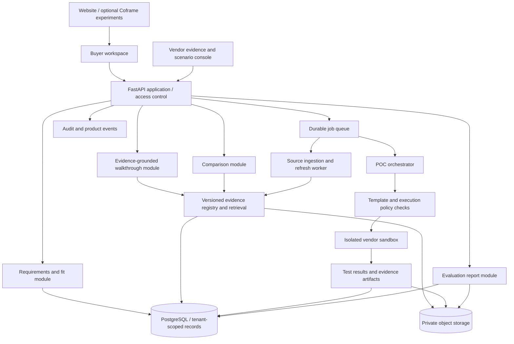

# Decision Layer — Enterprise Software Evaluation Platform

Repository: [abhijitbetigeri/DecisionLayer](https://github.com/abhijitbetigeri/DecisionLayer)

## Platform name and modules

**Decision Layer** is the platform name. Tagline: **Evidence-driven enterprise software evaluation.**

- **Visitor Lab:** Tests whether humans and AI agents can understand a vendor's website and reach accurate buying decisions. Builds on Second Visitor's simulated buyer runs, curated facts, correctness checks, and friction diagnostics; human usability validation follows separately.
- **Evaluation Workspace:** Helps enterprise buyers clarify requirements, explore tailored walkthroughs, execute bounded POCs, and compare products through versioned evidence. This is the module previously called ProofPath in this plan.

The modules share product facts, buyer requirements, evidence references, and decision rules. Visitor Lab identifies where presentation prevents accurate evaluation; Evaluation Workspace supplies the explanations and proof needed to resolve those gaps.

Use **Decision Layer**, **Visitor Lab**, and **Evaluation Workspace** in user-facing branding. References to Second Visitor and ProofPath below preserve implementation history and technical paths. The repository directory and Python project are named `decision-layer`. The `proofpath/` documentation directory, `sv/proofpath/` package proposal, and `PROOFPATH_*` configuration names retain their existing technical names.

Created and updated: October 10, 2026. Status: implementation specification for a one-day hackathon and subsequent pilot; the ProofPath implementation described here is not yet built.

**Implementation entry point:** Read the product context below, then follow “Hackathon implementation specification” for scope, contracts, work assignments, and acceptance checks. That specification takes precedence over the broader production architecture for the one-day build.

## Final two-hour implementation update

The final sprint added these implemented features:

| Feature | Implementation | Buyer benefit |
|---|---|---|
| Decision timeline | `sv/proofpath/insights.py`, `/api/v1/evaluations/{id}/insights`, and `static/insights.js` | Explains actual changes to decisions, findings, plans, and prices using stored comparison snapshots |
| Actionable next steps | Deterministic unresolved-hard-requirement actions, owners, and copyable requests | Turns unknown SSO, recovery, or cost evidence into a concrete follow-up; copying does not send anything |
| Historical evidence links | Evaluation-owned `/api/v1/evaluations/{id}/sources/{source_id}` and authorized run details | Lets buyers inspect the evidence behind earlier decisions without rewriting history |
| Visitor Lab results | `/visitor-lab`, `/api/v1/visitor-lab/results`, and `sv/proofpath/visitor_lab.py` | Shows recorded baseline-versus-evidence-context correctness, counts, Wilson intervals, errors, and provenance |

Visitor Lab displays the recorded 15/24 baseline and 24/24 evidence-context decisions when the validated summary is available. These are small offline agent measurements, not human conversion lift. Missing, invalid, or stub summaries withhold scores; page views do not trigger paid model sweeps.

Verification at completion: **91 automated tests passed**. Real Chrome acceptance passed both buyer paths at desktop/mobile widths: US operations reaches Fit after a bounded live mock POC; EU remains Needs verification with an SSO evidence request. Timeline refresh, competitor source approval, immutable report history, Visitor Lab rendering, and absence of page JavaScript errors were checked. Source and insights endpoints have session-ownership regression tests.

Reproduce browser checks with `uv run --with playwright python scripts/browser_acceptance.py`; it uses installed Chrome, temporary data, port 8021, and disabled model calls. Follow [the final four-minute demo script](demo/FINAL_DEMO.md). See [acceptance evidence](ACCEPTANCE.md) for the scope of checks.

Remaining release work: record the screen and narration, insert final team names and public URL into assets, rehearse within four minutes, and verify deployment once Docker/host access is available. Real-model availability and production readiness remain separate checks. Preserve the working local journey instead of adding new connectors or broad crawling before submission.

## Product in one sentence

ProofPath helps enterprise buyers understand a complex SaaS product, validate it against their environment, and compare alternatives through a guided, evidence-backed evaluation.

**Buyer journey:** Describe your problem → see how it works → prove it → compare your options.

**Initial promise:** Help enterprise prospects reach a substantiated buying decision with fewer discovery calls and less manual proof-of-concept work.

## Context: where this idea came from

The discussion began with Coframe, an AI-powered website conversion optimization platform. Coframe analyzes a website, generates variations of copy, CTAs, UI, layouts, and visuals, lets customers approve changes, then runs experiments and personalization to improve conversions. Its current positioning combines software with expert-managed optimization.

Relevant official references, consulted during the discussion:

- [Coframe product and workflow](https://www.coframe.com/)
- [Introduction and integration overview](https://coframe.mintlify.app/)
- [Segmentation and personalization](https://www.coframe.com/post/segmentation-personalization)
- [Variant creation](https://docs.coframe.com/editor/variant-creation)
- [Coframe blog shared by the user](https://www.coframe.com/blog)
- [Integration URL shared by the user — requires a real project ID](https://app.coframe.com/instructions/integration/PROJECT_ID)
- [Accessible generic integration template](https://app.coframe.com/instructions/integration/__PROJECT_ID__)
- [The Agentic Web Is Closer Than We Think](https://www.coframe.com/post/the-agentic-web-is-closer-than-we-think)
- [Predicting Website Experiment Winners Before You Spend the Traffic](https://coframe-d4f597.webflow.io/post/predicting-website-experiment-winners-before-you-spend-the-traffic)

These references explain Coframe; they do not establish that Coframe implements the proposed ProofPath capabilities. Product capabilities and integrations should be verified before implementation.

### Enterprise SaaS opportunities considered

| Enterprise problem | Website optimization opportunity | Meaningful outcome |
|---|---|---|
| Several buyer roles share one website | Tailor messaging and evidence by campaign or explicit role selection | Qualified demos by audience |
| Paid campaigns generate weak leads | Match landing pages to campaign intent | Cost per qualified opportunity |
| Visitors cannot understand a complex product | Test concrete workflows and explanations | Qualified trial/demo conversion |
| Buyers hesitate over security | Surface verified trust evidence near decision points | Enterprise evaluation progression |
| Pricing and plans are confusing | Clarify plan differences and purchase paths | Qualified conversions by plan |
| Demo forms lose prospects | Test form length, layout, and next-step expectations | Attended, qualified demos |
| Competitor searches fail to convert | Explain substantiated differences and migration effort | Opportunities from comparison pages |
| Industry pages are generic | Provide relevant workflows and customer evidence | Qualified pipeline by industry |
| Global messaging lacks relevance | Adapt examples and approved evidence by region | Qualified conversions by region |

Coframe documents segmentation by location, URL, visitor type, and device/platform. Role, industry, or named-account personalization requires an actual signal: a campaign URL, buyer selection, or verified integration. Do not assume anonymous visitors' roles or employers are known.

Initial website pilots could target paid landing pages, enterprise demo pages, and pricing pages. However, measuring form submissions alone can reward low-quality demand. Qualified pipeline per visitor is a stronger commercial outcome, with earlier conversion events used while longer sales outcomes mature.

### The three problems selected for ProofPath

1. **Complex products are difficult to consume.** Visitors cannot map capabilities to their problem, so vendors spend substantial sales and marketing effort educating and qualifying them.
2. **Enterprise buyers need proof before they trust the product.** They want a live POC and credible security evidence appropriate to their requirements.
3. **Buyers need a current competitive evaluation.** They must compare products against their own workflow, constraints, and budget to decide what to buy.

Better messaging can open the conversation. ProofPath carries it through a technical evaluation and a shareable decision record.

## Users and commercial model

Primary users are buyer champions, technical evaluators, security reviewers, and procurement teams. Vendor users are sales engineers, account executives, product marketing, and security specialists.

Start with a **vendor-funded workspace**. One vendor supplies documentation, approved demo scenarios, sandbox access, and human support. Disclose sponsorship in the workspace and comparison reports. The product must represent limitations and poor fit honestly, even when a competing product meets a requirement better.

A later **buyer-funded workspace** could evaluate multiple vendors independently. That requires broader access to vendor environments and evidence, along with a different trust and commercial model.

An initial design-partner hypothesis is an integration/workflow SaaS vendor with repeatable technical POCs. Validate that choice with customer interviews rather than treating it as established demand.

## Proposed buyer experience

### 1. Understand the buyer's problem

Collect the desired outcome, current systems, workflow, constraints, volume, budget assumptions, and acceptance criteria. Use guided questions alongside free text. Buyers confirm the resulting structured brief before the system recommends anything.

Example: “We run Salesforce, Snowflake, and an internal approval service. Can your product automate this workflow?”

Produce a tailored explanation showing relevant capabilities, data movement, dependencies, required integrations, implementation effort, and known gaps. A CTO may focus on architecture and security; an operations leader on workflow behavior; a finance stakeholder on cost assumptions. Those views come from explicit buyer context.

### 2. Explore a relevant walkthrough

Map the brief to a vendor-approved scenario and sample dataset. Show the happy path, failures, and recovery steps. Clearly label illustrative simulations, recorded demonstrations, and live execution.

For an integration platform, show an order-to-cash workflow across CRM, ERP, and billing systems. Distinguish a mocked integration from a working connection to the actual service.

### 3. Validate with a scoped POC

Agree on three to five acceptance tests, their inputs, expected outputs, and evaluation conditions. Start with synthetic data and approved templates. Provision an isolated environment, run the tests, capture evidence, and report outcomes.

| Requirement | Validation approach | Limit of the evidence |
|---|---|---|
| Restricted user access | Execute role/permission scenarios, including denied operations | Validates tested paths, not every authorization path |
| Traceable actions | Execute a workflow and inspect audit records | Shows observed logging behavior |
| Recoverable integration failures | Inject a controlled failure and exercise recovery | Applies to the tested failure mode |
| Specified data residency | Review deployment evidence and contractual commitments | UI behavior alone cannot establish residency |
| Performance target | Run a defined workload and record conditions | Results apply to that workload and environment |

A live POC does not establish security by itself. Combine observed behavior with architecture, access-control evidence, verified security documentation, and contractual commitments. Record who supplied or verified each item. Confidential reports require access control.

The evaluation report states what passed, failed, was blocked, or remains unverified. Buyers can share it with engineering, security, procurement, and executive stakeholders.

### 4. Compare alternatives dynamically

Compare products against the same confirmed requirements. Let buyers distinguish hard constraints from weighted preferences such as integration coverage, deployment options, implementation effort, and cost.

Every finding includes source, observation/retrieval date, applicable product version or plan where known, and evidence status:

- **Documented:** an attributable source states the capability.
- **Demonstrated:** an identified evaluation run observed the capability under recorded conditions.
- **Unknown:** available evidence does not establish the answer.
- **Contradicted:** evidence conflicts with the stated claim; review is required.

Unknown is not equivalent to failure. Conflicting and stale evidence remains visible. Refresh sources on a schedule and before a final decision; a newer page fetch does not automatically mean the underlying assertion is current. Avoid claiming equivalence from a shared feature name alone.

### 5. Hand off the decision context

With authorized sharing, provide sales with the buyer-confirmed brief, completed tests, blockers, and open questions. Give the buyer a useful report regardless of whether the product fits. CRM delivery is an optional later integration, not an assumed existing capability.

## Relationship to Coframe and Second Visitor

Coframe's scope extends beyond acquisition: its current product describes copy, visual, and UI generation, experimentation, and personalization. Its blog also discusses an autonomous growth agent. ProofPath applies this direction to enterprise evaluation: understanding requirements, producing evidence through scoped tests, and revising decisions when evidence changes. Coframe can experiment with approved messaging, entry points, and walkthrough presentation; ProofPath owns requirements, evidence, executable validation, and comparison logic. Coframe is optional; the workspace functions without it.

The agentic-web article calls for information-rich and action-rich interfaces. Our interpretation is to provide human views and structured agent endpoints backed by the same evidence and permitted actions. The article is a statement of direction, not proof that Coframe ships our proposed evaluation backend.

The generic integration template documents a browser installation configured by project ID, optional antiflicker behavior, conversion tracking, analytics callbacks, tracking-only mode, consent settings, and feature-flag controls. It does not establish a POC provisioning API, competitor research API, or API for constructing our complete workspace. A project-specific installation and current conversion-call contract must be verified before use. `PROJECT_ID` and `__PROJECT_ID__` are placeholders, not working credentials.

Coframe's experiment-prediction research recommends candidate screening rather than replacing live experiments with model predictions. Second Visitor likewise measures correctness on curated synthetic briefs; those results are distinct from actual human conversion or pipeline lift.

Second Visitor already provides a useful foundation for testing whether AI visitors can reach correct decisions from website evidence:

| Existing component | Observed behavior | Proposed extension |
|---|---|---|
| `sv/site/` | FastAPI/Jinja website variants with product, pricing, and trust pages | Evaluation entry points and approved walkthrough templates |
| `sv/facts.py` | YAML facts, buyer briefs, and deterministic qualification oracle | Versioned requirements and evidence-backed fit rules |
| `sv/guard.py` | LLM-assisted factual claim review | Evidence references and approval gates across generated artifacts |
| `sv/simulator/` | Offline buyer-agent runs against website variants | Evaluate comprehension, correct fit decisions, and evidence discovery |
| `sv/diagnose.py` | Classifies struggles such as hidden prices and missing requirements | Diagnose evaluation friction and unresolved buyer questions |
| `sv/events.py` | Event logging for runs | Correlated evaluation and POC audit events |

Important implementation detail: the current guard blocks contradicted claims but reports unsupported claims for review; its `passed` result does not require those reviews to be resolved. A production publication gate should hold unresolved factual claims until approved. LLM claim extraction also needs coverage checks and human review for consequential claims.

The existing deterministic oracle works on a bounded curated fact set. It should remain a correctness benchmark for those facts; open-ended enterprise fit and competitive claims cannot be assumed to have an equally complete oracle. Simulated buyer improvements must later be validated with real users.

## Proposed architecture

Begin with a modular application and background workers. Separate sandbox execution from the application control plane because execution has different permissions, resource limits, and failure modes.



### Application modules

1. **Workspace and identity:** Tenant membership, evaluation membership, stakeholder roles, invitations, and expiring share links. Start with buyer, vendor reviewer, and tenant administrator roles. Access checks apply to database rows and artifacts.
2. **Requirements:** Turn conversations into schema-validated briefs. Record buyer confirmation, hard constraints, preference weights, assumptions, and changes. The model proposes structure; application code validates it.
3. **Evidence registry:** Store immutable source versions, approved assertions, citations, access classification, applicable plans/versions, review status, and freshness metadata. Use full-text retrieval initially; add embeddings if retrieval quality warrants them.
4. **Walkthrough generator:** Retrieve approved evidence and select a maintained scenario. Generate explanations with claim references. Show gaps explicitly. Use deterministic templates for executable steps and sensitive claims.
5. **POC orchestrator:** Run approved scenario templates through vendor-specific adapters. Provision, seed, execute, collect, and tear down environments. Persist progress so retries and worker restarts are safe.
6. **Comparison engine:** Match evidence to buyer requirements, enforce hard constraints, and calculate transparent preference scores. Distinguish documented capabilities from measured results.
7. **Reporting and handoff:** Build a versioned HTML report with an optional PDF export. Record requirement coverage, test conditions, citations, limitations, remaining questions, and sponsorship. Sharing is an explicit action.
8. **Analytics:** Connect acquisition source, evaluation progress, sales effort, and downstream opportunity outcomes when available. Keep simulated results separate from actual buyer metrics.

### Suggested implementation choices

Reuse Python, FastAPI, and Jinja for an initial server-rendered workspace, matching the existing project. Add PostgreSQL for durable multi-user records and private object storage for source documents and test artifacts. Use a durable queue with a Python worker for ingestion and POC jobs. Begin with one vendor sandbox adapter rather than a universal provisioning abstraction.

These are proposed choices, not provisioned infrastructure. Select hosting, identity, queue, and storage providers after checking the first vendor's isolation, region, retention, and deployment requirements. A richer frontend can follow once interaction needs justify it.

### Core records

| Record | Essential fields |
|---|---|
| Tenant / Membership | Organization, user, role, status |
| Evaluation | Tenant, buyer organization, owner, stage, approved brief version |
| Requirement | Evaluation, type, hard constraint, weight, acceptance criteria |
| Product / Plan | Vendor, plan/version, effective dates |
| SourceVersion | Origin, content hash, retrieved date, published date if available, access classification |
| Claim | Product, assertion, source references, status, reviewer, applicability |
| ScenarioVersion | Workflow, prerequisites, approved steps, test definitions, resource limits |
| POCRun | Evaluation, scenario version, state, sandbox reference, expiry, idempotency key |
| TestResult | Run, test, expected/observed outcome, status, artifact references |
| ComparisonSnapshot | Requirements version, products, evidence versions, scoring version, unresolved items |
| ReportVersion / AuditEvent | Snapshot references, sharing scope / actor, action, time, correlation ID |

Tenant and evaluation scope must be enforced server-side. Keep service credentials in a secrets manager; records contain references rather than raw credentials.

### Execution and evidence flow

1. Vendor submits approved documentation and a supported demo scenario.
2. Ingestion snapshots sources, extracts candidate assertions, and routes them for review.
3. Buyer submits and confirms requirements; the application retrieves relevant approved evidence.
4. The workspace explains fit, gaps, and the proposed POC. Buyer and vendor approve any setup needing their resources or data.
5. Orchestration validates the scenario and provisions a bounded sandbox with short-lived credentials.
6. Workers execute predefined tests and capture outputs. Deterministic assertions grade executable tests; models may summarize results but cannot change their status.
7. Comparison and reporting use frozen evidence and requirements versions. Refreshing a source creates a new snapshot rather than silently rewriting a decision report.
8. Sandbox expiry triggers cleanup, credential revocation, and a recorded cleanup result. Failures alert the operator and retry within limits.

POC states: `draft → awaiting_approval → queued → provisioning → running → completed/failed/cancelled → cleaning_up → closed`. Preserve the run outcome separately from cleanup state, and allow cleanup from every state in which resources may exist.

### Comparison scoring

Evaluate hard constraints first using `met`, `unmet`, or `unknown`. An unresolved hard constraint prevents a claim of confirmed fit; it should not silently disqualify a product.

For preferences, display both a score on evaluated criteria and coverage:

`evaluated_score = sum(weight × rubric_score) / sum(weights of evaluated criteria)`

`coverage = sum(weights of evaluated criteria) / sum(all preference weights)`

Define each rubric before comparing products. Do not rank a high score with low coverage as an unqualified winner. Show unknown criteria and buyer-adjustable weights. Estimated costs must state seats, usage, term, implementation, support, and quote assumptions. A custom quote remains unknown until obtained.

### Trust and operational boundaries

- Models explain and propose; approved adapters and application policies authorize execution. Retrieved pages are untrusted input, including any embedded instructions.
- Start with synthetic data. Real buyer data requires scoped authorization, agreed retention, region selection, and credential controls.
- Sandbox isolation includes tenant boundaries, resource quotas, restricted outbound destinations, expiry, and cleanup. Never execute arbitrary model-generated shell commands as a POC.
- Public competitor ingestion uses permitted public sources and constrained fetchers. Prevent access to internal network addresses, credentials, and arbitrary destinations.
- Security statements cite actual evidence; a successful test is not a certification or comprehensive security assessment.
- Preserve source provenance, sponsor disclosure, confidential document permissions, and signed/expiring artifact access.
- Use job idempotency, bounded retries, cancellation, timeouts, and operator escalation. Redact sensitive content from logs and model inputs as appropriate.

## MVP and delivery sequence

### Phase 1: Understand and explain

One vendor, one repeatable workflow, manually curated evidence, confirmed requirements, an approved walkthrough, and an exportable fit report. Reuse Second Visitor briefs and simulations to identify confusing presentation. No live competitive crawling is necessary yet.

### Phase 2: Prove

Add one isolated sandbox adapter with three to five deterministic acceptance tests, synthetic data, approval, teardown, and evidence capture. Deliver an evaluation report covering passed, failed, blocked, and unverified requirements.

### Phase 3: Compare

Add two or three alternatives, reviewed public evidence, scheduled refresh, hard constraints, transparent scoring, and immutable comparison snapshots. Offer buyer feedback and vendor corrections without rewriting previous reports.

### Phase 4: Optimize and integrate

Add optional Coframe entry-point experiments, authorized CRM handoffs, stakeholder collaboration, and additional vendor adapters. Validate that changes improve real buyer decision quality as well as conversion.

The first sellable pilot is a vendor-specific guided evaluation with a bounded live POC and report. Universal autonomous POCs, unrestricted customer-system access, and comprehensive competitive coverage are outside the initial scope.

## Example end-to-end evaluation

A buyer wants to sync CRM opportunities into a warehouse and trigger an internal approval workflow. They require restricted access, visible audit records, failure recovery, and a specified deployment region.

ProofPath confirms the brief, explains supported connections and any custom work, and runs a synthetic approved scenario. It tests a successful sync, a denied action, an audit event, and a recoverable integration failure. Residency is checked against appropriate deployment and contractual evidence rather than inferred from the demo.

The report shows observed results and open questions. Alternatives are compared against the same requirements; a competitor's documented feature is not represented as independently tested. If a mandatory requirement remains unknown, the decision is “needs verification.” If a verified gap makes the product unsuitable, the report states that clearly.

## Success measures and validation

Business measures: evaluation completion, qualified opportunities per visitor, time to technical decision, sales engineering hours per opportunity, and eventual win rate. Interpret win rate alongside buyer fit and channel mix.

Quality measures: evidence coverage, unsupported claim rate, correct fit decisions on curated briefs, citation validity, unresolved hard constraints, and buyer-rated usefulness. Operational measures: sandbox provisioning success, execution reproducibility, cleanup success, and cost per evaluation.

Before a pilot, verify access isolation, source provenance, stale/conflicting evidence handling, honest unknowns, reproducible tests, failure/cancellation cleanup, and report permissions. Use real buyer reviews in addition to synthetic visitors. Do not treat simulation gains as proven pipeline lift.

## Decisions still to validate

- Which vendor category has the most repeatable POCs and strongest willingness to pay?
- Which workflow and acceptance tests recur often enough to template?
- Will the vendor supply supported sandbox APIs and maintain scenario versions?
- Which security evidence can be shared publicly, privately, or only under NDA?
- Who owns evidence review and how quickly must stale claims be rechecked?
- How will sales qualification and opportunity outcomes be linked with buyer consent?
- Will buyers trust sponsor-disclosed competitor comparisons, or prefer a separate buyer-funded product?

The immediate next step is to recruit a design partner, observe its current discovery-to-POC process, and select one workflow with explicit acceptance criteria and a measurable sales-engineering baseline.

## Hackathon implementation specification

### Objective and fixed scope

Build a living enterprise SaaS website that helps humans and their agents verify product fit. Demonstrate three visible changes: the interface adapts to a buyer brief; a real bounded test produces evidence; an approved source update changes the evaluation while preserving the old report.

Use **FlowBridge**, a fictional integration vendor, plus fictional alternatives **RelayWorks** and **PipeStack**. Display “Fictional products and evidence; live tests use local mock integrations.” Do not imply real Salesforce or Snowflake integration certification, live enterprise deployment, or actual security certification.

The one-day scope is one workflow, three brief presets, two stakeholder views, four executable assertions, three products, one controlled evidence update, a structured agent endpoint, and an HTML evaluation report. POC execution is real code against local mocks; vendor capability and pricing evidence are fixtures. General crawling, production tenant provisioning, CRM writes, full identity, PDF generation, and arbitrary workflow generation are later work.

### Four-minute presentation

| Time | Action | Visible result |
|---|---|---|
| 0:00–0:30 | Open generic FlowBridge homepage | Features, pricing, illustrative trust section, “Book a demo,” and “Evaluate my use case” |
| 0:30–1:30 | Submit EU/SSO/recovery brief and confirm requirements | Workflow, requirement matrix, evidence, POC controls, open questions; switch technical/finance view |
| 1:30–2:30 | Click “Prove it” | Live successful sync, injected failure, bounded retry, and duplicate count assertion |
| 2:30–3:20 | Trigger labeled fixture update and approve evidence | Diff, stale comparison indicator, updated cost/fit explanation, preserved old report |
| 3:20–4:00 | Run buyer agent and open report | “Needs verification,” citations, demonstrated recovery, documented EU option, unverified SSO |

Opening: “Enterprise software websites make buyers do the translation. What if the website could demonstrate whether the product fits?”

Closing: “This website builds an evaluation around your problem, runs the proof, and revises the decision when the evidence changes.”

### Homepage and workspace

Homepage hero: “Connect your systems. Automate your business.” Navigation: Product, Integrations, Enterprise, Pricing. Features: prebuilt connectors, workflow builder, reliable execution, enterprise controls. Suggested fictional monthly plan prices: Team $299, Business $999, Enterprise custom. Any capability or badge must be derived from the fixture facts; SSO remains unverified in the default brief, so do not render an unconditional SSO or SOC 2 certification badge. Use “Review security evidence” instead.

Primary evaluation input: “We need to sync Salesforce opportunities into Snowflake, require EU hosting and SSO, and need failed syncs to recover without duplicate records.”

Workspace panels:

1. Confirmed brief and editable requirements.
2. Workflow diagram: CRM source → FlowBridge sync → warehouse destination.
3. Requirement matrix with `met/unmet/unknown`, evidence basis, applicability, and citations.
4. POC plan, explicit mock labels, run controls, live events, and inspectable artifacts.
5. Comparison table with hard constraints, preference score, coverage, and gaps.
6. Evidence-change banner and version diff.
7. Versioned report and agent result.

Technical view foregrounds workflow, evidence, and tests. Finance view foregrounds plan assumptions, quote unknowns, and implementation costs. Switching views does not change truth, requirement weights, or test outcomes. Provide loading, empty, failed, cancelled, and stale states; never leave a perpetual spinner.

### Implementation layout and runtime

Keep the existing Pulse A/C/D site and simulator intact. Build a separate package inside the already-packaged `sv` directory, so existing packaging includes it without introducing another frontend build system.

```text
proofpath/
  README.md                        # This source-of-truth plan
sv/proofpath/
  app.py                           # FastAPI composition and routes
  contracts.py                     # Shared Pydantic schemas and enums
  repository.py                    # SQLite persistence and transactions
  requirements.py                  # Parsing, validation, confirmation
  evidence.py                      # Fixture ingestion, review, snapshots
  evaluation.py                    # Fit calculation and workspace projection
  comparison.py                    # Deterministic rubric and coverage
  reports.py                       # Immutable report snapshots
  telemetry.py                     # Internal events and conversion intent
  coframe.py                       # Optional adapter/config validation
  agent.py                         # Structured buyer-agent demonstration
  poc/
    adapter.py                     # Approved local mock adapter
    runner.py                      # Durable lifecycle and execution
  templates/                       # Homepage, workspace, report, admin
  static/                          # CSS and small browser JS modules
  fixtures/                        # Products, claims, briefs, update scenario
tests/proofpath/                    # Contract and behavioral verification
```

Baseline runtime: FastAPI/Jinja, minimal JavaScript with polling, Pydantic validation, SQLite via Python standard library, and local artifacts outside version control. Add a test dependency only if needed; do not change existing model routing silently. Use the existing `sv/llm.py` abstraction if model-assisted parsing or agent execution is enabled. Inspect its interface before implementing an adapter.

Planned start command: `uv run uvicorn sv.proofpath.app:app --host 127.0.0.1 --port 8001`. This becomes valid after implementation. Run existing Pulse separately on port 8000 if demonstrating its simulator. A browser opens the FlowBridge homepage at `/`.

For the hackathon, persistent SQLite jobs can be processed by one bounded application worker, with polling for status. On startup mark interrupted running jobs failed/interrupted and clean their run directories; do not pretend they resumed successfully. Production replaces this with durable external workers and stronger sandbox isolation.

### Contract freeze: shared domain types

All agents import `contracts.py`; no independent payload definitions. Use schema version `1`, UUID identifiers, UTC ISO timestamps, immutable version IDs, and string enums. The API owner publishes valid example payloads before parallel implementation begins.

| Type | Required contract |
|---|---|
| BriefVersion | `id`, `evaluation_id`, `version`, `goal`, `systems`, `persona`, `requirements`, `confirmed_at` (nullable), `created_at` |
| Requirement | `id`, `key`, `label`, `hard`, `weight`, `expected`, `acceptance_criteria` |
| SourceVersion | `id`, `source_id`, `product_id`, `origin`, `content_hash`, `retrieved_at`, `published_at` (nullable), `content`, `fictional` |
| Claim | `id`, `source_version_id`, `requirement_key`, `value`, `plan`, `evidence_status`, `review_status`, `reviewed_at` (nullable) |
| Finding | `requirement_id`, `product_id`, `status`, `basis`, `claim_ids`, `test_result_ids`, `reason`, `limitations` |
| POCRun | `id`, `evaluation_id`, `brief_version_id`, `scenario_version`, `state`, `outcome`, `idempotency_key`, `created_at`, `expires_at` |
| TestResult | `id`, `run_id`, `test_key`, `status`, `expected`, `observed`, `artifact_ids`, `limitations` |
| ComparisonSnapshot | `id`, `brief_version_id`, `source_version_ids`, `run_ids`, `rubric_version`, `products`, `created_at` |
| ReportVersion | `id`, `evaluation_id`, `brief_version_id`, `comparison_snapshot_id`, `run_ids`, `findings`, `created_at` |
| Event | `id`, `sequence`, `evaluation_id`, `run_id` (nullable), `type`, `payload`, `created_at` |

Enums: finding status `met/unmet/unknown`; evidence status `documented/demonstrated/unknown/contradicted`; review status `pending/approved/rejected`; test status `pass/fail/blocked`; fit decision `fit/not_fit/needs_verification`. Evidence basis and requirement status are separate: documented support can satisfy a documentation criterion but cannot satisfy a requirement explicitly demanding a live demonstration.

Decision rule: any verified unmet hard constraint → `not_fit`; otherwise any unknown/conflicted hard constraint → `needs_verification`; otherwise → `fit`. Preference score never overrides hard constraints. If no preferences are evaluated, score is `null`; zero total preference weight yields `null` coverage. Display “Not enough evaluated evidence” rather than divide by zero.

Changed requirements create a new brief version and invalidate the current workspace projection. Historical runs and reports remain associated with their original brief. Reuse test evidence only after explicit scenario/requirement compatibility checks; default to requiring a new run.

### HTTP contracts

Base prefix: `/api/v1`. Return `{schema_version: 1, data: ...}` on success and `{schema_version: 1, error: {code, message, details}}` on errors. HTTP status: 400 invalid operation, 404 missing resource, 409 version/state conflict, 422 invalid schema, 503 unavailable optional service. Server-generated IDs are opaque; validate IDs before filesystem use.

| Method / path | Input and output |
|---|---|
| `POST /evaluations` | `{brief_text, preset_id?}` → evaluation ID and unconfirmed parsed brief |
| `PUT /evaluations/{id}/brief` | `{expected_version, goal, systems, persona, requirements}` → new unconfirmed version |
| `POST /evaluations/{id}/confirm` | `{brief_version_id}` → confirmed brief and deterministic findings |
| `GET /evaluations/{id}/workspace` | Current projection, sources, findings, comparison, available scenario, run status |
| `POST /evaluations/{id}/runs` | `{brief_version_id, scenario_version, idempotency_key}` → run ID; HTTP 202 |
| `GET /runs/{run_id}` | State, outcome, results, and artifact metadata |
| `POST /runs/{run_id}/cancel` | Idempotent cancellation request |
| `GET /evaluations/{id}/events?after={sequence}` | Ordered cursor-based events; browser polls without duplicates |
| `POST /demo/source-update` | Operator-only `{scenario_id}` → pending source version and diff |
| `POST /sources/{version_id}/review` | Operator-only `{decision}` → review outcome; approved version triggers a new current comparison |
| `POST /evaluations/{id}/reports` | `{brief_version_id, comparison_snapshot_id}` → immutable report ID |
| `GET /reports/{report_id}` | Frozen JSON report; HTML view at `/reports/{report_id}` |
| `GET /evaluations/{id}/agent-context` | Same facts/citations/limitations as human workspace; read-only |
| `POST /evaluations/{id}/agent-evaluation` | Bounded model agent or labeled deterministic fallback → decision with citations |
| `GET /artifacts/{artifact_id}` | Validated lookup and authorized download; no arbitrary paths |
| `GET /health` | Readiness and optional service status, without credentials |

Use a locally issued session cookie and evaluation ownership checks for browser/agent reads and writes. Operator actions require a separate token kept server-side or supplied through a dedicated operator session; never expose it in public page JS. This is a local-demo boundary, not production authentication. Bind to localhost by default. Public deployment requires real identity, access control, CSRF protection, secure transport, and rate limits first.

### Fixture matrix and expected decisions

All fixture sources are local, labeled, versioned, and viewable through citations. Fixture claims are approved at seed time except the controlled update. Maintain the homepage, comparison, and agent response from the same facts.

| Product | EU deployment | SSO | Recovery/idempotency | Pricing |
|---|---|---|---|---|
| FlowBridge | Documented Business/Enterprise option | Unknown in initial evidence | Documented; local mock test can demonstrate bounded behavior | Team $299; Business $999; Enterprise quote |
| RelayWorks v1 | Documented Business option | Documented Business capability | Documented only; no independent run | Business $899/month |
| RelayWorks v2 update | Enterprise-only EU option | Same as v1 | Same as v1 | Enterprise quote unknown |
| PipeStack | US-only documented | Documented | Unknown | Business $699/month |

Presets:

- **EU technical:** CRM-to-warehouse sync, EU and SSO hard requirements, demonstrated recovery required; FlowBridge is `needs_verification` due to SSO even after its POC passes.
- **US operations:** Same workflow, US supported, recovery demonstration hard requirement, SSO optional; FlowBridge progresses from `needs_verification` to `fit` after a successful run.
- **Strict budget:** EU workflow with $900/month ceiling as a hard constraint; FlowBridge Business is `not_fit`. RelayWorks v1 meets the documented EU/cost criteria, but its recovery remains unverified if demonstration is required. RelayWorks v2 has unknown quote-based cost; never claim a confirmed budget fit.

Source-update action is explicitly “Simulate competitor evidence update.” Before approval, show affected current evaluations as requiring review without adopting the candidate claim. After approval, rebuild current comparisons and append `comparison_updated`; leave historical reports unchanged. Rejecting the update clears the pending indicator and preserves the previously approved source.

### Executable POC definition

Scenario ID/version: `crm_warehouse_sync/v1`. Use a run-specific SQLite destination table and a Python mock CRM source, labeled Salesforce/Snowflake stand-ins. No external credentials or outbound calls are required.

Four assertions:

1. Successful insert of synthetic opportunity `opp-001` with expected field values.
2. Controlled temporary failure before committing a second delivery; emit retry event.
3. Bounded retry succeeds using the same idempotency key.
4. A repeated delivery leaves exactly one destination record for the tested key.

The failure should be part of the adapter's behavior, not a hardcoded UI animation. Persist request IDs, attempt counts, final destination count, and assertion outputs as artifacts. Do not claim durability against every crash scenario or production connector correctness from this test.

Set a 30-second run deadline, maximum three delivery attempts, one concurrent run per evaluation, and bounded artifact size. Repeat POST with the same idempotency key and payload returns the original run; different payload with the same key returns 409. Cleanup occurs on success, failure, timeout, cancellation, and startup recovery. Keep non-sensitive result artifacts for reports; remove temporary destination resources. Any deliberate presentation delay must be configurable and cannot determine outcomes.

### LLM and deterministic execution boundaries

Models may parse buyer text into candidate requirements, propose component ordering from an allowlist, summarize cited findings, and act as a buyer consuming the structured API. Models cannot approve claims, invent evidence, change pass/fail results, modify arbitrary files, run shell commands, or select unrestricted execution tools.

Always validate model output; invalid or unavailable output falls back to an explicit preset or guided form. An actual buyer-agent demo records model identity, input version, cited evidence, answer, and correctness against fixture expectations. A deterministic fallback is labeled “Rule-based evaluation,” not “AI agent.” Limit agent turns and time, and reject citations to nonexistent records.

### Coframe integration plan

1. Obtain a real Coframe project ID and its generated integration instructions. Do not reuse the placeholder or a legacy installation snippet without verification.
2. Install the generated script on the homepage and intended measurement pages. For above-the-fold edits, follow the documented synchronous installation/antiflicker setup, including a bounded reveal fallback.
3. Restrict experiments to approved copy, CTA placement, walkthrough entry points, and presentation containers. Reserve requirement findings, test outcomes, source citations, and decision fields for application-owned rendering.
4. Implement internal events independently: `brief_confirmed`, `poc_started`, `poc_completed`, `report_created`, and `qualified_evaluation_completed`. `qualified_evaluation_completed` requires confirmed current requirements, no unresolved hard constraints, and current approved evidence; it is a technical-fit milestone, not a CRM-qualified opportunity.
5. Map approved event names through a small browser adapter only after verifying the project's current conversion-call syntax. Browser calls send event names and permitted identifiers, not buyer brief text or security documents. Missing SDK never blocks evaluation.
6. Record treatment metadata through the supported analytics callback if available. Keep human, simulated buyer, and replay events separate so agent runs do not inflate conversion metrics.
7. Validate initialization in the browser and exercise the documented disable path (`cf_disable`). Verify the same factual findings and POC outcomes with Coframe enabled and disabled.

If no real project is available, show “Coframe integration not configured” and internal metrics only. The demo must not imply an experiment ran through Coframe when it did not. Coframe SDK presence alone also does not establish that browserless agents receive the same treatment; our structured endpoint is maintained separately from the canonical facts.

### Event contract and replay

New event names: `brief_parsed`, `brief_confirmed`, `workspace_generated`, `poc_queued`, `poc_started`, `poc_attempt`, `poc_test_result`, `poc_finished`, `poc_cleanup_finished`, `source_change_detected`, `source_reviewed`, `comparison_updated`, `report_created`, `agent_evaluation_finished`.

Use SQLite for durable ordered events. Do not rename or change existing `sv/events.py` simulator event contracts. A separate exporter can produce sanitized JSONL recordings. Replay shows an explicit “Recorded replay” badge and never emits live Coframe conversions or fabricates a live POC. A reset action clears only ProofPath demo state, retaining checked-in fixtures and existing Pulse `runs/` files.

## Multi-agent implementation work plan

This section defines future implementation ownership; writing this plan does not itself launch implementation agents. A coordinating agent freezes contracts first, then assigns non-overlapping files. Agents exchange interfaces and blockers through the coordinator rather than editing each other's modules.

| Workstream | Files owned | Deliverable and done criteria | Dependencies |
|---|---|---|---|
| Coordinator / API | `app.py`, `contracts.py`, `repository.py`, packaging/config, API contract tests | Freeze schemas; create migrations; enforce ownership/errors/version conflicts; wire routes and worker; one-command startup | First workstream; integrates all outputs |
| Evidence and decisions | `requirements.py`, `evidence.py`, `evaluation.py`, `comparison.py`, `fixtures/`, matching tests | Three presets, sourced findings, approval/diff, immutable comparison, transparent fit/score/coverage | Frozen contracts and repository interface |
| POC execution | `poc/`, matching tests | Real failure/retry/upsert assertions, idempotency, cancellation/deadline/cleanup, artifacts and events | Run/event repository interface |
| Experience and reporting | `templates/`, `static/`, `reports.py`, report/view tests | Homepage transforms into workspace; persona switch; polling states; citations; frozen report; readable mobile layout | API examples initially; real routes at integration |
| Agent and measurement | `agent.py`, `coframe.py`, `telemetry.py`, matching tests | Honest live/fallback agent result; verified optional SDK adapter; event separation and replay export | Stable agent-context/event contracts |

If only four agent slots are available, run Coordinator plus Evidence, POC, and Experience first. Assign Agent/measurement to a freed slot after Evidence or POC finishes. Do not block the core demo on optional Coframe access or an LLM key.

Shared repository interface to freeze: create/get evaluation; append/get brief version; confirm brief transactionally; store/get source version and review; store/get comparison; enqueue/get/update run with expected state; append/list ordered events; store/list results and artifacts; create/get immutable report. Return validated domain objects. All writes requiring multiple records occur in transactions.

Coordination rules:

- Contracts and migration edits belong to the coordinator. Propose changes before implementation; update examples and consumers together.
- Use mocks matching published schemas until dependencies land. Integrate a vertical slice before expanding component polish.
- Each workstream reports changed files, verification, unsupported assumptions, and integration needs.
- Avoid editing existing Pulse behavior or dependency lockfiles concurrently. Coordinator owns shared config and dependency changes.
- Do not read, overwrite, commit, or expose unrelated `.env` files. Add only named optional variables to an example file.
- No agent deploys, publishes, sends CRM messages, or provisions paid resources as part of the local implementation plan.

### One-day execution schedule

| Relative time | Checkpoint |
|---|---|
| Hour 0–1 | Freeze contracts, seed fixture truth, start app, agree on expected decisions |
| Hour 1–3 | Parallel brief/evidence pipeline, POC runner, and homepage/workspace |
| Hour 3–4 | Integrate first slice: submit → confirm → findings → live test → report |
| Hour 4–5 | Controlled update, immutable history, comparison refresh, agent endpoint |
| Hour 5–6 | Buyer-agent execution and optional real Coframe configuration |
| Hour 6–7 | Behavioral checks, failure cleanup, visual polish, recordings |
| Hour 7–8 | Rehearse four-minute story; freeze working build and prepare replay |

When time is constrained, preserve live POC execution, accurate findings, evidence update, and report history. Reduce visual variants and optional SDK features first.

## Acceptance checklist and handoff

### Required end-to-end checks

- Fresh startup seeds fixtures once; a second startup preserves evaluations and history.
- Three presets yield expected decisions; unknown SSO never becomes a confirmed security capability.
- Brief edits require confirmation and invalidate current conclusions without rewriting old reports.
- Technical/finance view switches preserve facts, scores, and evidence references.
- Live POC captures actual attempts, demonstrates bounded retry/idempotency, and exports inspectable results.
- Duplicate run requests do not execute twice; cancellations, failures, and deadline expiry clean temporary resources.
- A pending source update cannot silently become approved truth; approval changes current comparisons and rejection preserves current approved evidence.
- Reports preserve their source versions and results after updates. Comparison guards division by zero and reports unknown coverage.
- Agent and human views use the same evidence, IDs, and fit rules. Unsupported model citations are rejected.
- Ownership checks prevent another session from reading an evaluation, report, or artifact; operator actions reject missing authorization.
- Coframe missing/disabled does not break the journey. Live, simulated, and replay events remain separate.
- Homepage → brief → run → update → report works in a browser with visible failure states and no essential console errors.

Test deterministic decision logic, state transitions, isolation, immutable snapshots, and POC assertions with meaningful automated tests. Use a browser smoke test or recorded manual walkthrough for UI behavior. Do not run the old LLM-based guard as the only verification of factual correctness.

### Required implementation handoff artifacts

Before declaring the implementation ready, add exact tested startup/test commands, optional environment-variable descriptions, a demo reset command, fixture-update instructions, example API payloads, a four-minute rehearsal script, and known limitations to this document or linked files in `proofpath/`. Commands in this plan are targets until verified against implemented code.

Proposed optional configuration names: `PROOFPATH_DATA_DIR`, `PROOFPATH_DEMO_MODE`, `PROOFPATH_OPERATOR_TOKEN`, `PROOFPATH_COFRAME_PROJECT_ID`, `PROOFPATH_ENABLE_LLM`. Keep secrets out of committed files and browser bundles. Public project identifiers may be passed only where the official integration requires them.

### Production evolution after the hackathon

Replace local-demo session controls with organization identity and tenant authorization; SQLite/local artifacts with production persistence and private storage; the bounded local worker with a durable queue; mock connectors with vendor-supported adapters; fixtures with reviewed and access-controlled source ingestion. Add retention policies, regional hosting, monitored teardown, rate limits, and real-user evaluation before claiming enterprise readiness.

The hackathon proves the interaction and evidence loop. A production pilot must prove reliability, vendor integration quality, buyer trust, and reduced technical-evaluation effort.
