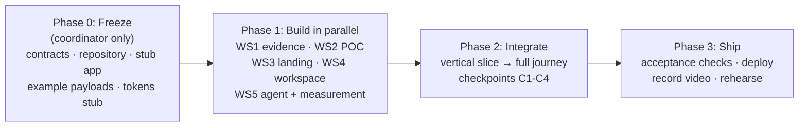

# Decision Layer build plan: multi-agent playbook

User-facing names: **Decision Layer** (platform), **Visitor Lab** (Second Visitor engine),
**Evaluation Workspace** (previously ProofPath). Technical paths keep their names: `proofpath/`,
`sv/proofpath/`, `PROOFPATH_*`.

Status: **implementation in progress.** Core modules are present. WS6-WS8 have been implemented through assistant collaboration agents; see their status reports for verification and remaining release work.

**Source of truth for product behaviour:** [../README.md](../README.md), section "Hackathon
implementation specification". This playbook decides *who builds what, in which order, and how the
pieces come together*. If the two disagree on behaviour, the README wins; if they disagree on
process, this playbook wins.

## Files in this plan

| File | For | Contents |
|---|---|---|
| `README.md` (this) | everyone | phases, ownership, rules, schedule, status board |
| [shared-truth.md](shared-truth.md) | every agent | requirement keys, fixture facts, expected decisions per preset, models, design tokens |
| [workstreams/ws0-coordinator.md](workstreams/ws0-coordinator.md) | coordinator | contracts, repository, app skeleton, stubs, auth, worker |
| [workstreams/ws1-evidence.md](workstreams/ws1-evidence.md) | agent 1 | fixtures, brief parsing, evidence review, decision rule, comparison |
| [workstreams/ws2-poc.md](workstreams/ws2-poc.md) | agent 2 | mock adapter, POC runner, lifecycle, artifacts |
| [workstreams/ws3-landing.md](workstreams/ws3-landing.md) | agent 3 | FlowBridge landing page with **taste-skill**, design tokens |
| [workstreams/ws4-workspace.md](workstreams/ws4-workspace.md) | agent 4 | workspace panels, polling, persona switch, report HTML |
| [workstreams/ws5-agent-measurement.md](workstreams/ws5-agent-measurement.md) | agent 5 | buyer agent, Jev, simulator hook, telemetry, Coframe adapter |
| [integration.md](integration.md) | coordinator | merge order, checkpoints, smoke tests, acceptance |
| [deployment.md](deployment.md) | coordinator | local demo, public URL, secrets, fallback |
| [demo-video.md](demo-video.md) | coordinator + user | 4-minute live script, video shot list, assets, rehearsal |
| [EXTERNAL_AGENTS.md](EXTERNAL_AGENTS.md) | user | copy-paste prompts to launch extra agents for WS6-WS8 |
| [workstreams/ws6-deploy.md](workstreams/ws6-deploy.md), [ws7-demo-assets.md](workstreams/ws7-demo-assets.md), [ws8-qa.md](workstreams/ws8-qa.md) | extra agents | deploy, demo assets, QA (run in separate sessions) |

## Phases

| Phase | Who | Exit criterion |
|---|---|---|
| **0. Freeze** | Coordinator alone | `contracts.py` imports cleanly; `examples/*.json` validate against it; the stub app on :8001 serves every route in the README's HTTP table with example payloads; `shared-truth.md` decisions encoded as a test that currently fails |
| **1. Build** | 5 agents in parallel, one per workstream | each workstream's own "done" checklist passes against stubs/mocks |
| **2. Integrate** | Coordinator | checkpoints C1-C4 in [integration.md](integration.md) pass |
| **3. Ship** | Coordinator + user | README acceptance checklist, deployment, video, rehearsal |

## How parallel agents stay out of each other's way

1. **File ownership is exclusive.** Each workstream lists the files it owns. An agent never edits
   another workstream's files; it reports the need to the coordinator instead.
2. **Contracts are frozen in Phase 0.** All payloads come from `sv/proofpath/contracts.py`. A
   contract change goes through the coordinator, who updates the contract, the examples and
   every consumer in one step.
3. **Build against stubs.** Until a dependency lands, use `sv/proofpath/examples/*.json` (UI)
   or the repository interface with an in-memory fake (logic). Never invent a payload shape.
4. **Shared truth is one file.** Expected decisions, requirement keys, prices and design tokens
   live in [shared-truth.md](shared-truth.md). If code disagrees with it, the code is wrong.
5. **Same working tree; only the coordinator commits.** Agents work in the one local checkout and never
   commit or push. The coordinator commits and pushes to github.com/abhijitbetigeri/DecisionLayer
   (main) at checkpoints. Exclusive file ownership replaces branches. `uv.lock`,
   `pyproject.toml` and `app.py` belong to the coordinator only.
6. **Report format** when a workstream finishes: files changed, how it was verified (commands
   and output), assumptions not covered by the plan, and integration needs.
7. **Never touch:** `.env`, Pulse (`sv/site`, `sv/simulator`, `sv/facts.py`, `data/`), existing
   `runs/` files, `sv/events.py` contracts. WS5 may *import* the simulator, never edit it.
8. **Honesty rules carry into code:** fictional labels visible, no invented evidence, a model
   never decides pass/fail, an AI fallback is labeled "Rule-based evaluation".

## Ownership map

| Path under `sv/proofpath/` | Owner |
|---|---|
| `app.py`, `contracts.py`, `repository.py`, `auth.py`, `worker.py`, `examples/`, `__init__.py` | WS0 coordinator |
| `requirements.py`, `evidence.py`, `evaluation.py`, `comparison.py`, `fixtures/` | WS1 |
| `poc/` | WS2 |
| `templates/home.html`, `templates/_base.html`, `static/tokens.css`, `static/home.css`, `static/home.js`, `static/img/` | WS3 |
| `templates/workspace.html`, `templates/report.html`, `templates/_partials/`, `static/workspace.js`, `static/workspace.css`, `reports.py` | WS4 |
| `agent.py`, `telemetry.py`, `sim_bridge.py` | WS5 |
| `tests/proofpath/test_<module>.py` | owner of `<module>` |
| `Dockerfile`, `.dockerignore`, `deploy/`, `scripts/deploy.sh`, `public_guard.py` | WS6 (extra agent) |
| `proofpath/demo/` | WS7 (extra agent) |
| `tests/proofpath/test_api_journey.py`, `test_isolation.py`, `scripts/smoke.sh`, `scripts/demo_reset.sh`, `proofpath/ACCEPTANCE.md` | WS8 (extra agent) |
| `proofpath/plan/status/<ws>.md` | that workstream (extra agents report here) |

## Schedule: 2.5 hours total

| Clock | Milestone |
|---|---|
| 0:00-0:20 | **Phase 0 freeze** (coordinator): contracts, repository, stub app, example payloads |
| 0:20-1:30 | **Phase 1**: 5 subagents in parallel. WS3 ships `tokens.css` in its first 15 minutes |
| 1:30-2:00 | **Phase 2**: C1 vertical slice, then C2 evidence update, then C3 agent + landing |
| 2:00-2:20 | Visitor Lab numbers (C4, WS5), record video takes, 3 slides |
| 2:20-2:30 | Freeze build, one timed rehearsal |

**Cut for the 2.5-hour build:** Coframe SDK (no real project; `__PROJECT_ID__` is a doc
placeholder), public deployment (stretch only), replay export beyond a JSONL dump, landing-page
motion beyond hover/focus states, Lighthouse runs.

**When time runs short, protect:** live POC, accurate findings, evidence update with history,
report. **Cut first:** Coframe, simulator chart, finance view polish, landing-page motion.

## Status board (coordinator keeps this current)

### Final two-hour enhancements

Implemented decision history from stored snapshots, actionable owner-assigned evidence requests, historical source links with evaluation access checks, and a Visitor Lab results page at `/visitor-lab`. Recorded A/B measurements retain counts, intervals, provenance, and limitations. Missing/stub/invalid measurements are withheld.

Verification: **91 automated tests passed**. Real Chrome acceptance passed US fit and EU uncertainty paths, live POCs, timelines, next steps, report generation, approved evidence change with frozen report history, desktop/mobile layouts, Visitor Lab results, and no page JavaScript errors. Run `uv run --with playwright python scripts/browser_acceptance.py` to reproduce. See [final rehearsal instructions](../demo/FINAL_DEMO.md). Final narration/video editing and public deployment remain release work.

Recording support is now implemented and exercised: add `--record` to capture a labeled real walkthrough and screenshots in `proofpath/demo/recordings/` (ignored generated artifacts). The final narrated edit and public deployment remain release work.

| Workstream | State | Notes |
|---|---|---|
| WS0 freeze | **done** | contracts, repository, app + stubs, examples, auth, worker, decision tests |
| WS1 evidence | **done** | 81 tests; 14/14 expected decisions |
| WS2 POC | **done** | 10/10 tests; real worker path verified; UI notes relayed to WS4 |
| WS3 landing | **done** | taste-skill pre-flight passes; hero renders live showcase data |
| WS4 workspace | **done** | agent stalled in final checks; coordinator verified in browser |
| WS5 agent | **done** | live gpt-oss-120b cited needs_verification; telemetry wired |
| WS6 deploy | artifacts complete; release pending | Container/config/scripts and quota middleware verified; Docker daemon unavailable, InsForge access unknown, no public deployment |
| WS7 demo assets | complete | Slides, architecture, 1080p cards, narration/captions, real-results chart generator; recording/team/URL inputs pending |
| WS8 QA | complete | 10 new QA tests; full suite 59 passed; temporary-data smoke and acceptance mapping supplied |
| Integration C1-C4 | **all pass** (C3 headless browser: home → workspace → POC → report, 0 console errors, 375px OK). Visitor Lab: homepage 15/24 (62%) vs agent-context 24/24 (100%) | coordinator |
| Video recording + edit | not started | coordinator + user, after build freeze |
