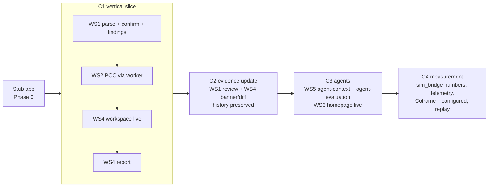

# Integration plan (Phase 2, coordinator)

Integrate a **vertical slice first**, then widen. After every step, run the smoke script and the
test suite. Never start the next checkpoint with the previous one red.

## Merge order

## Checkpoints

| Checkpoint | Replace stubs with | Pass criteria |
|---|---|---|
| **C1 vertical slice** | WS1 `requirements`, `evaluation`; WS2 `runner` via `worker`; WS4 workspace + report | Demo brief → confirm → FlowBridge `needs_verification` with SSO Unknown → "Prove it" → 4 passes live in UI → recovery becomes Demonstrated → FlowBridge still `needs_verification` (SSO) → report created. `us_operations` reaches `fit` after the POC. |
| **C2 evidence update** | WS1 `evidence`, `comparison`; WS4 banner/diff | Simulate RelayWorks v2 → pending shows "Requires review" without adopting it → approve → comparison updates, `comparison_updated` event → **report from C1 still shows v1** → reject path keeps prior evidence. `strict_budget`: RelayWorks budget becomes `unknown`. |
| **C3 agents + landing** | WS5 `agent`; WS3 homepage | Homepage submit creates an evaluation; `agent-context` facts and ids equal the human view; gpt-oss-120b agent returns `needs_verification` with valid citations; fake citation rejected; LLM off → "Rule-based evaluation". |
| **C4 measurement + extras** | WS5 `sim_bridge`, `telemetry`, `coframe`, replay | Arm A vs Arm B numbers with n and intervals; human/sim/replay counters separate; Coframe absent path clean (present path only with a real project id); replay badge visible and no live conversions. |

## Smoke script (`scripts/smoke.sh`, coordinator writes it in Phase 0, extends per checkpoint)

1. Start the app on a fresh `PROOFPATH_DATA_DIR`; `GET /health` is ready.
2. API-only journey with curl + jq: create → confirm → run → poll until terminal → assert 4
   passes → report → simulate update → approve → assert old report unchanged.
3. Restart the app on the same data dir: evaluations and history are still there; fixtures not
   duplicated.
4. Duplicate run POST with the same key → same run id; different payload → 409.
5. Second session cookie → 404/403 on the first session's evaluation, report and artifact.
6. Operator routes without a token → rejected.

## Conflict protocol

- Contract mismatch found during integration → the coordinator fixes `contracts.py` + examples,
  then asks the owning workstream to adapt (or adapts it directly if trivial and the agent has finished).
- Two workstreams need the same file → it moves to the coordinator.
- A failing acceptance item is logged on the status board with an owner before moving on.

## Final acceptance

Run the README's "Required end-to-end checks" list in full, plus a browser walkthrough of the
four-minute script at 1280px and 375px in both themes. Record results in `proofpath/ACCEPTANCE.md`.
